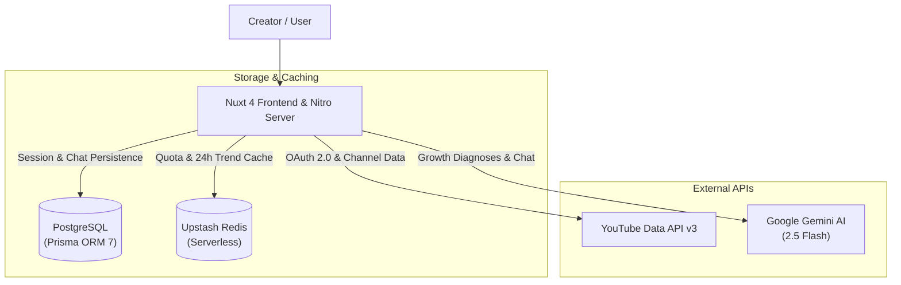

# ⚡ YT Analyzer — AI YouTube Intelligence & Creator Studio

<div align="center">

[](https://nuxt.com)
[](https://vuejs.org)
[](https://www.typescriptlang.org)
[](https://tailwindcss.com)
[](https://ui.nuxt.com)
[](https://www.prisma.io)
[](https://www.postgresql.org)
[](https://upstash.com)
[](https://ai.google.dev)
[](https://developers.google.com/youtube/v3)

**A high-performance SaaS analytics platform for YouTube creators, built with Nuxt 4, Prisma 7, PostgreSQL, Upstash Redis, and Google Gemini AI.**  
Inspect any creator, benchmark viral outlier videos, pit channels head-to-head, discover breakout trending content with zero quota overhead, and chat with an AI growth strategist.

</div>

---

## 🚀 Key Features

### 1. 🔍 Deep Channel Analyzer & Outlier Detection
- **Instant Creator Audit:** Inspect metrics across any creator or competitor by typing `@handle`, channel ID, or pasting any video/channel URL.
- **Viral Outlier Multiplier:** Automatically detects breakout videos performing **≥ 1.5x up to 4x+ above the channel's baseline average view count**.
- **In-Depth Video Diagnostic Modal:**
  - **Stats & Metrics:** Real-time engagement rate (ER), duration, like-to-view ratios.
  - **A/B Title Formulas:** AI-generated high-converting headline variations based on emotional and curiosity triggers.
  - **SEO & Search Tags:** SEO health score (0-100), tag generation with 1-click copy to clipboard.
  - **Hook & Retention Audit:** AI analysis of the first 30 seconds, drop-off risks, and retention leak prevention.
- **Recent Searches Memory:** Persisted in Pinia store and `localStorage` with in-memory caching to guarantee zero redundant API hits.

### 2. ⚔️ Side-by-Side Head-to-Head Compare
- **Competitor Rivalry Battles:** Benchmark two creators simultaneously with dual-colored dynamic proportion bars (Blue vs Rose theme).
- **Metric Winner Badges:** Instant detection of who is dominating in Subscribers, Lifetime Views, Upload Volume, and Average Views per Video with lead multipliers (e.g., `+3.8x Ahead`).
- **Popular Rivalry Presets:** 1-click presets (*MrBeast vs T-Series*, *MKBHD vs Dave2D*, *Veritasium vs Mark Rober*, etc.).
- **AI Snapshot Comparison:** Generates side-by-side strategic strengths for both channels.

### 3. 📡 Niche & Viral Content Radar (100 Trending Videos)
- **Real-Time YouTube Trends:** Pulls 100 trending videos and Shorts across major categories (*Tech & Science, Gaming, Entertainment, Comedy, How-to, Sports, etc.*).
- **Viral Velocity Metric (`views/hr`):** Measures hourly acceleration to spotlight breakout videos before they plateau.
- **Content Type Switcher:** Instant filtering between **All (100)**, **Long-form Videos**, and **⚡ Shorts**.
- **1-Click Creator Deep Dive:** Directly transitions any trending creator into the Channel Analyzer with a single click.
- **AI Trend Breakdown:** Seamlessly launches a tailored prompt in the AI Strategy Chat to diagnose why a specific video concept went viral.

### 4. 🤖 AI Creator Strategy Chat (Gemini 2.5 Flash)
- **VidIQ-Inspired Growth Workspace:** Persistent, multi-session chat interface connected to Google Gemini.
- **Context-Aware Insights:** Automatically pre-fills comprehensive channel statistics, outlier benchmarks, and niche trends into the AI context.
- **Streaming Output Animation:** Progressive text animation streaming from top to bottom with auto-scroll.
- **Sanitized Markdown Rendering:** Beautifully formatted responses with highlighted code snippets, bullet points, callouts, and DOMPurify XSS protection.

### 5. 🎙️ Creator Studio Sync (Google OAuth 2.0)
- **Seamless 1-Click Connection:** Authenticates via Google OAuth requesting read-only YouTube scopes (`youtube.readonly`).
- **Auto-Provisioning:** Fetches the logged-in user's own channel, captures performance snapshots, and saves records into PostgreSQL.
- **Isolated Pinia State:** Decouples user channel analytics from search queries so browsing competitors never overwrites personal channel data.

---

## 🏗️ Architecture & Engineering Highlights



### ⚡ Zero-Quota Caching Strategy
YouTube Data API imposes strict daily quotas (10,000 units/day). To ensure high availability and prevent quota exhaustion:
- **Niche Radar 24h Cache:** The 100 trending videos are cached in Upstash Redis (`yt:niche:popular:v1:${region}:${category}`) with a **24-hour TTL (86,400s)**. Users browsing niches consume **0 quota units** (served from cache in <10ms).
- **Video Feed 6h Cache:** Channel uploads are cached for 6 hours (`yt:videos:v4:${channelId}:${limit}`).
- **In-Memory Store Caching:** Pinia maintains an in-memory dictionary of searched channels by normalized handle and ID to avoid repeating identical queries during a single session.

### 🛡️ Multi-Tier Rate Limiting & Atomic Quota Rollback
1. **Global YouTube Quota:** Daily limit (10,000 units) tracked against Pacific Time midnight resets. If an API request fails, quota is atomically rolled back via Redis `decrby`.
2. **Per-User Quotas:** Authenticated users receive daily allowances (300 YouTube API units, 30 AI strategy prompts) tracked in Redis.
3. **Sliding Window IP Rate Limiting:** Redis sorted sets (`ZREMRANGEBYSCORE`, `ZCARD`) protect endpoints against brute force and DDoS attacks.

---

## 🛠️ Tech Stack

| Layer | Technology | Description |
|---|---|---|
| **Framework** | **Nuxt 4.5** | Full-stack Vue 3 meta-framework with Nitro engine |
| **Language** | **TypeScript 6.0** | Strict typing across frontend, server routes, and database models |
| **Styling & UI** | **Tailwind CSS v4** + **Nuxt UI v4** | Modern dark-mode-first design system with `@nuxt/ui` components |
| **State Management** | **Pinia 4.0** | Reactive stores with `localStorage` search persistence |
| **Database** | **PostgreSQL** + **Prisma ORM 7** | Relational data persistence using `@prisma/adapter-pg` driver adapter |
| **Caching & Limits** | **Upstash Redis** | Serverless key-value store for API caching & rate limiters |
| **Artificial Intelligence** | **Google Gemini 2.5 Flash** | Low-latency LLM for content audits, SEO generation, and growth chat |
| **Authentication** | **nuxt-auth-utils** | Encrypted HTTP-only cookie sessions with Google OAuth 2.0 |
| **Markdown & Security** | **marked** + **isomorphic-dompurify** | GFM parsing with client/server XSS sanitization |

---

## 📂 Project Structure

```
youtube-analyzer/
├── app/
│   ├── assets/css/main.css       # Tailwind v4 theme & typography styling
│   ├── components/               # UI components (TopVideosList, StatsOverview, Sidebar, etc.)
│   ├── composables/              # useFormatters, useMarkdown (DOMPurify)
│   ├── middleware/auth.ts        # Route protection for studio & chat
│   ├── pages/
│   │   ├── index.vue             # Channel Analyzer & Guest Landing Page
│   │   ├── my-channel.vue        # Creator Studio (personal channel stats)
│   │   ├── compare.vue           # Head-to-head competitor comparisons
│   │   ├── niches.vue            # 100 trending videos & viral velocity radar
│   │   └── assistant.vue         # VidIQ-style Gemini AI strategy chat
│   └── stores/channel.ts         # Pinia store with recent searches & isolated caching
├── prisma/
│   ├── migrations/               # PostgreSQL migration history
│   └── schema.prisma             # Database schema (User, ChatSession, Channel, etc.)
├── server/
│   ├── api/
│   │   ├── channel.get.ts        # Channel resolver with handle normalization
│   │   ├── videos.get.ts         # Video fetcher with duration & short detection
│   │   ├── niche-videos.get.ts   # 100 popular videos endpoint (Redis cached)
│   │   ├── video-insight.post.ts # Gemini video diagnostic & SEO generator
│   │   └── chat/                 # Chat sessions CRUD & Gemini streaming endpoint
│   ├── routes/auth/google.get.ts # Google OAuth callback & channel auto-link
│   └── utils/                    # Redis, Prisma, and Quota limiter utilities
├── nuxt.config.ts                # Nuxt configuration with runtime configs & module setup
├── prisma.config.ts              # Prisma 7 CLI configuration
└── .env.example                  # Environment variable reference
```

---

## 💻 Getting Started

### Prerequisites
- **Node.js** >= 20.x
- **pnpm** >= 9.x (recommended)
- A **PostgreSQL** database (e.g. Supabase, Neon, or local Postgres)
- An **Upstash Redis** database
- A **Google Cloud Console** project with **YouTube Data API v3** enabled
- A **Google Gemini API Key**

### 1. Clone the repository
```bash
git clone https://github.com/your-username/youtube-analyzer.git
cd youtube-analyzer
```

### 2. Install dependencies
```bash
pnpm install
```

### 3. Configure environment variables
Copy the example environment file and fill in your credentials:
```bash
cp .env.example .env
```

### 4. Run database migrations
Deploy the Prisma schema to your PostgreSQL database:
```bash
pnpm prisma migrate deploy
```

### 5. Start the development server
```bash
pnpm dev
```
Open [http://localhost:3000](http://localhost:3000) in your browser.

---

## 🔒 Security & Data Privacy
- **Read-Only Access:** The application requests strictly `https://www.googleapis.com/auth/youtube.readonly` and cannot alter or delete any YouTube content.
- **Encrypted Sessions:** User sessions are sealed in encrypted HTTP-only cookies powered by `nuxt-auth-utils`.
- **Sanitized Outputs:** All LLM outputs are processed through DOMPurify to eliminate Cross-Site Scripting (XSS) risks.
- **IDOR Protection:** Chat sessions and user quotas are strictly validated against session user IDs on every server endpoint.

---

## 📄 License
This project is licensed under the MIT License — see the [LICENSE](LICENSE) file for details.
